# Documentação Funcional e Técnica — Módulo Criar Pedido

**Projeto:** PlatFarmaSupa (Sermail)  
**Rota abrangida:** `/pedidos`

---

## 1. Visão Geral

O módulo **Criar Pedido** (`/pedidos`) é o ponto central de emissão de ordens de expedição e encomendas logísticas na plataforma **PlatFarmaSupa**. Permite aos clientes proprietários (`user1`, `user2`) e à equipa interna (`admin`, `gestor`) registar pedidos de saída de armazém com seleção inteligente de lotes segundo a regra **FEFO** (*First Expired, First Out*), gestão integrada de destinos arquivados, reserva imediata de stock disponível no Armazém `01` (Venda) e disparo automático de notificações por e-mail com anexos Excel nativos (`.xlsx`).

### Arquitetura e Fluxo de Dados

```mermaid
%%{init: {
  'theme': 'base',
  'themeVariables': {
    'background': '#d1d5db',
    'mainBkg': '#e2e8f0',
    'primaryColor': '#f8fafc',
    'primaryTextColor': '#0f172a',
    'primaryBorderColor': '#334155',
    'lineColor': '#1e293b',
    'secondaryColor': '#e2e8f0',
    'tertiaryColor': '#cbd5e1',
    'clusterBkg': '#e2e8f0',
    'clusterBorder': '#475569',
    'titleColor': '#0f172a',
    'edgeLabelBackground': '#cbd5e1',
    'nodeTextColor': '#0f172a',
    'textColor': '#0f172a'
  },
  'themeCSS': 'svg { background-color: #d1d5db !important; border-radius: 10px; padding: 12px; } .labelBkg, .edgeLabel, .edgeLabel rect, .edgeLabel span, .edgeLabel p { background-color: #cbd5e1 !important; fill: #cbd5e1 !important; color: #0f172a !important; } .nodeLabel, .cluster-label span, .cluster-label p, text, tspan { color: #0f172a !important; fill: #0f172a !important; }'
}}%%
flowchart TD
    subgraph Canvas ["Mapa de Arquitetura e Fluxo de Dados — Página Criar Pedido (/pedidos)"]
        subgraph Origem ["Fontes de Dados (Supabase PostgreSQL)"]
            T_CLI["clientes (Ativos)"]
            V_STK["vw_stock_pedidos (Armazém 01 - Stock > 0)"]
            T_DST["destinos (Moradas Arquivadas)"]
        end

        subgraph Server ["Next.js Server Component & Actions"]
            P_PED["/pedidos (page.tsx - Promise.all + RBAC)"]
            A_DST["criarDestinoAction (actions.ts)"]
            A_PED["criarPedidoAction (actions.ts)"]
        end

        subgraph Client ["Interface Interativa (NovoPedidoForm - novo-pedido-form.tsx)"]
            SEC1["1. Dados do Pedido (Cliente, Ref. Doc, Data Entrega)"]
            SEC2["2. Destinatário (Código Rápido, Lista ou Novo Destino)"]
            SEC3["3. Editor de Linhas com Sugestão FEFO Automática"]
            SEC4["4. Tabela de Linhas + Validação de Stock Disponível"]
            SEC5["5. Observações + Flag Contabilizar Stock + Submissão"]
        end

        subgraph Persistencia ["Persistência, Stock e Notificações"]
            DB_PED["pedidos + pedido_linhas (Status: pendente)"]
            RPC_MOV["RPC sincronizar_pedido_para_movimentos (se stock = true)"]
            RESEND["Resend Email + ExcelJS (Pedido_*.xlsx & Template-Pedidos_*.xlsx)"]
        end

        T_CLI & V_STK & T_DST --> P_PED
        P_PED --> SEC1 & SEC2 & SEC3
        SEC2 -- "Modal Novo Destino" --> A_DST
        A_DST --> T_DST
        SEC3 --> SEC4 --> SEC5
        SEC5 -- "Submeter Pedido" --> A_PED
        A_PED --> DB_PED
        A_PED --> RPC_MOV
        A_PED --> RESEND
    end

    style Canvas fill:#cbd5e1,stroke:#64748b,stroke-width:2px,color:#0f172a
    style Origem fill:#fef3c7,stroke:#d97706,stroke-width:2px,color:#78350f
    style Server fill:#e0f2fe,stroke:#0284c7,stroke-width:2px,color:#0c4a6e
    style Client fill:#e2e8f0,stroke:#475569,stroke-width:2px,color:#0f172a
    style Persistencia fill:#d1fae5,stroke:#059669,stroke-width:2px,color:#064e3b

    style T_CLI fill:#f8fafc,stroke:#b45309,stroke-width:2px,color:#78350f
    style V_STK fill:#f8fafc,stroke:#b45309,stroke-width:2px,color:#78350f
    style T_DST fill:#f8fafc,stroke:#b45309,stroke-width:2px,color:#78350f

    style P_PED fill:#f8fafc,stroke:#0369a1,stroke-width:2px,color:#0c4a6e
    style A_DST fill:#f8fafc,stroke:#0369a1,stroke-width:2px,color:#0c4a6e
    style A_PED fill:#f8fafc,stroke:#0369a1,stroke-width:2px,color:#0c4a6e

    style SEC1 fill:#f8fafc,stroke:#334155,stroke-width:2px,color:#0f172a
    style SEC2 fill:#f8fafc,stroke:#334155,stroke-width:2px,color:#0f172a
    style SEC3 fill:#f8fafc,stroke:#334155,stroke-width:2px,color:#0f172a
    style SEC4 fill:#f8fafc,stroke:#334155,stroke-width:2px,color:#0f172a
    style SEC5 fill:#f8fafc,stroke:#334155,stroke-width:2px,color:#0f172a

    style DB_PED fill:#f8fafc,stroke:#047857,stroke-width:2px,color:#064e3b
    style RPC_MOV fill:#f8fafc,stroke:#047857,stroke-width:2px,color:#064e3b
    style RESEND fill:#f8fafc,stroke:#047857,stroke-width:2px,color:#064e3b

    linkStyle default stroke:#1e293b,stroke-width:2px,color:#0f172a
```

### Arquitetura de Ficheiros
| Ficheiro | Função Principal |
| :--- | :--- |
| `src/app/pedidos/page.tsx` | *Server Component* da rota `/pedidos`; valida a sessão via `getAuthContext()`, aplica o isolamento multi-tenant (`userClientId`) e carrega em paralelo (`Promise.all`) os clientes ativos (`clientes`), o stock disponível para venda (`vw_stock_pedidos` com `stock > 0`) e o catálogo de destinos (`destinos`). |
| `src/app/pedidos/novo-pedido-form.tsx` | *Client Component* interativo do formulário de criação de pedidos: gere os dados do cabeçalho, pesquisa rápida de destinos por código, modal de criação de destino, motor de sugestão FEFO em $O(1)$ e validação de quantidades por lote. |
| `src/app/pedidos/actions.ts` | *Server Actions* `criarDestinoAction` e `criarPedidoAction`; executam a validação RBAC no servidor, geram a numeração do pedido (`nr_pedido` e `sigla_pedido`), gravam em `pedidos` e `pedido_linhas`, invocam a RPC de stock e disparam os e-mails transacionais. |
| `src/lib/email.ts` & `src/lib/excel.ts` | Geração em memória dos ficheiros Excel (`Pedido_<nr_pedido>.xlsx` e `Template-Pedidos_<nr_pedido>.xlsx`) e envio assíncrono via API **Resend**. |

---

## 2. Controlo de Acesso (RBAC) e Isolamento por Cliente

O comportamento da página adapta-se automaticamente ao perfil do utilizador autenticado:

| Perfil | Seleção de Cliente Proprietário | Opção "Contabilizar em Stock" | Visibilidade de Stock e Destinos |
| :--- | :--- | :--- | :--- |
| **`admin` / `gestor`** | Seletor *dropdown* livre com todos os clientes ativos (`[SIGLA] Nome`). | Checkbox visível (ativa por defeito; permite criar pedidos que não abatem stock quando desmarcada). | Acesso ao stock de venda (`vw_stock_pedidos`) e destinos do cliente selecionado no formulário. |
| **`user1` / `user2`** | Campo bloqueado (*read-only*) fixado na empresa associada ao perfil (`profile.cliente_id`). | Sempre ativo (`stock = true` forçado no servidor em `criarPedidoAction`). | Filtrado ao nível da query SQL (`eq('cliente_id', userClientId)`) apenas para a sua empresa. |

---

## 3. Estrutura Funcional do Formulário (5 Secções)

### 3.1 Secção 1 — Dados do Pedido (Painel Superior Esquerdo)
- **Cliente Proprietário (`*`)**: Identifica o laboratório/proprietário dos artigos. A mudança de cliente limpa automaticamente o destinatário e as linhas em edição para evitar cruzamento de referências entre clientes.
- **Referência do Documento (`ref_documento`)**: Campo livre opcional para indicar o número da encomenda interna ou ordem de compra do cliente.
- **Data de Entrega Pretendida (`data_entrega`)**: Seletor de data opcional (a data do pedido `data_pedido` assume automaticamente a data atual `YYYY-MM-DD`).

### 3.2 Secção 2 — Destino / Destinatário (Painel Superior Direito)
Oferece três métodos complementares para preencher os dados de expedição:
1. **Pesquisa Rápida por Código (`buscarDestinoPorCodigo`)**:
   - Aceita o código completo (ex.: `CRD-0001`), sigla sem hífen (`CRD0001`) ou apenas o número sequencial (`1`, `01`, `0001`), compondo automaticamente o prefixo `[SIGLA]-0001` e preenchendo todos os campos de morada.
2. **Seleção por Lista Pull-Down**:
   - Lista todos os destinos ativos do cliente (`[CODIGO] Nome (Classificação) - Localidade (Código Postal)`).
3. **Criação de Novo Destino**:
   - **Via Modal Dedicado (`+ Novo Destino`)**: Invoca `criarDestinoAction`, gravando imediatamente na tabela `public.destinos` (onde um *trigger* PostgreSQL atribui automaticamente o código sequencial `[SIGLA]-0001`) e selecionando-o no formulário.
   - **Via Checkbox Inline**: Se o utilizador preencher manualmente um destinatário novo e assinalar *"Guardar estes dados e classificação como novo destino arquivado"*, `criarPedidoAction` cria o registo em `public.destinos` no momento da submissão do pedido.
- **Campos Obrigatórios do Destinatário**: Nome do Destinatário (`*`), Classificação do Destino (`*` — ex.: `Farmácia`, `Hospital`, `Grossista`, `Outros`, etc.), Morada (`*`), Código Postal (`*`), Localidade (`*`) e País (por defeito `Portugal`).

### 3.3 Secção 3 — Adição de Linhas com Motor FEFO Inteligente
- **Agrupamento e Ordenação FEFO em Memória (`lotesPorArtigoMap`)**:
  - Os registos de `vw_stock_pedidos` do cliente selecionado são indexados num `Map<artigo_id, StockPedido[]>` e ordenados por data de validade ascendente ($\text{Validade mais próxima primeiro}$):
    $$\text{Ordem dos Lotes} = \text{sort}\big(\text{Date.parse}(\text{validade}_A) - \text{Date.parse}(\text{validade}_B)\big)$$
- **Sugestão Automática**:
  - Ao escolher um artigo no primeiro *dropdown*, o segundo *dropdown* seleciona automaticamente o primeiro lote da fila FEFO (assinalado com `⭐ [FEFO]`), exibindo número do lote, data de validade e saldo disponível (`un`).
- **Validação de Quantidade**:
  - O campo numérico limita o máximo ao stock disponível no lote selecionado (`max = currentLoteObj.stock`).

### 3.4 Secção 4 — Tabela de Linhas do Pedido e Acumulação Validada
- Lista todas as linhas adicionadas com número de ordem (`#`), código do artigo, descrição, lote, validade, quantidade formatada e botão de remoção individual.
- **Regra de Acumulação por Lote**:
  - Se o utilizador adicionar novamente o mesmo par `(artigo_id, lote)`, a quantidade é somada à linha já existente, validando que a soma acumulada não ultrapassa o saldo disponível do lote:
    $$\text{Qtd}_{\text{acumulada}} = \text{Qtd}_{\text{existente}} + \text{Qtd}_{\text{nova}} \le \text{Stock Disponível}_{\text{lote}}$$

### 3.5 Secção 5 — Observações, Flag de Stock e Submissão
- **Observações (`observacoes`)**: Notas logísticas ou instruções de entrega.
- **Checkbox `Contabilizar em Stock`** (exclusivo `admin`/`gestor`): Define o booleano `pedidos.stock` (`true` por defeito).
- **Botão Submeter**: Apresenta o total de unidades do pedido e bloqueia cliques duplicados durante o processamento (`loading`).

---

## 4. Fluxo Transacional no Servidor (`criarPedidoAction`)

Ao submeter o formulário, a *Server Action* `criarPedidoAction` executa sequencialmente 6 etapas:

1. **Validação RBAC e Integridade**: Confirma a sessão no Supabase Auth, força `targetClientId = profile.cliente_id` caso o utilizador não seja `admin`/`gestor` e valida a presença dos campos obrigatórios e de pelo menos uma linha com `quantidade > 0`.
2. **Geração de Identificadores do Pedido**:
   - `nr_pedido`: Formato `PED-<ANO>-<4 DÍGITOS>` (ex.: `PED-2026-4821`).
   - `sigla_pedido`: Formato `<SIGLA_CLIENTE>-<nr_pedido>` (ex.: `AOP-PED-2026-4821`).
3. **Inserção do Cabeçalho (`public.pedidos`)**:
   - Regista o pedido com `status = 'pendente'`, `tipo_movimento = 'SS'`, `doc_primavera = null` e `stock = finalStock`.
4. **Inserção das Linhas (`public.pedido_linhas`)**:
   - Grava todas as linhas associadas ao `pedido.id` com `artigo_id`, `artigo_cli`, `descricao`, `lote`, `validade` e `quantidade`.
5. **Contabilização em Stock (`stock = true`)**:
   - Quando `pedido.stock === true`:
     - As *views* `vw_stock_atual` e `vw_stock_pedidos` deduzem imediatamente as quantidades reservadas no **Armazém 01 (Venda)** enquanto o pedido não transitar para movimento processado (`processar = true`).
     - É invocada a RPC `sincronizar_pedido_para_movimentos(p_pedido_id)` para sincronização logística.
6. **Envio Paralelo de E-mails (`Promise.allSettled`) e Invalidação de Cache**:
   - Dispara dois fluxos de e-mail via **Resend** (`src/lib/email.ts`):
     - `enviarEmailConfirmacaoPedido`: Envia confirmação HTML + anexo Excel `Pedido_<nr_pedido>.xlsx` para o utilizador criador e destinatários configurados.
     - `enviarEmailTemplatePedidoAdmin`: Envia o ficheiro técnico de integração `Template-Pedidos_<nr_pedido>.xlsx` (com armazém, tipo de artigo, família e subfamília) para os destinatários de administração/operação.
   - Executa `revalidatePath` nas rotas `/pedidos`, `/dashboard`, `/historico-pedidos`, `/stocks` e `/Proc_Pedidos`.

