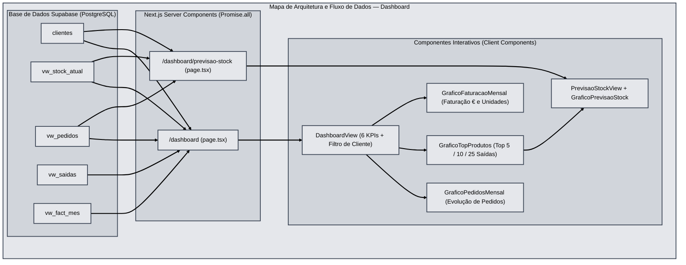

# Documentação Funcional e Técnica — Módulo Dashboard e Previsão de Stock

**Projeto:** PlatFarmaSupa (Sermail)  
**Rotas abrangidas:** `/dashboard` e `/dashboard/previsao-stock`

---

## 1. Visão Geral

O módulo de **Dashboard** constitui o centro de inteligência operacional e analítica da plataforma **PlatFarmaSupa**, disponibilizando em tempo real indicadores-chave de desempenho (KPIs), evolução temporal de pedidos, ranking de produtos expedidos, análise financeira de faturação e um motor preditivo de **Previsão de Stock e Ponto de Encomenda**.

### Arquitetura e Fluxo de Dados

### Arquitetura de Ficheiros
| Ficheiro | Função Principal |
| :--- | :--- |
| `src/app/dashboard/page.tsx` | *Server Component* principal do Dashboard; autentica a sessão, aplica isolamento por cliente e carrega em paralelo (`Promise.all`) os dados das *views* PostgreSQL. |
| `src/app/dashboard/dashboard-view.tsx` | *Client Component* que gere o filtro de cliente, calcula os 6 KPIs de topo e controla a navegação instantânea entre os separadores de gráficos. |
| `src/app/dashboard/grafico-pedidos-mensal.tsx` | Gráfico interativo da evolução mensal de pedidos e variações percentuais mês-a-mês (MoM). |
| `src/app/dashboard/grafico-top-produtos.tsx` | Gráfico e tabela analítica dos artigos com maior volume de saídas (`Top 5`, `Top 10`, `Top 25`), com ligação direta à Previsão de Stock de cada artigo. |
| `src/app/dashboard/grafico-faturacao-mensal.tsx` | Gráfico financeiro e de volume mensal de faturação (Mercadoria, IVA, Descontos, Valor Líquido e Unidades). |
| `src/app/dashboard/previsao-stock/page.tsx` | *Server Component* da página dedicada de Previsão de Stock (`/dashboard/previsao-stock`). |
| `src/app/dashboard/previsao-stock/previsao-stock-view.tsx` | *Client Component* de controlo dos parâmetros preditivos (*Run-Rate*, Horizonte de Projeção, Tipo de Visualização e Cliente). |
| `src/app/dashboard/grafico-previsao-stock.tsx` | Motor matemático e gráfico SVG de projeção de stock futuro, abate de lotes por caducidade, cálculo de autonomia e determinação geométrica do **Ponto de Encomenda**. |

---

## 2. Fontes de Dados e Controlo de Acessos (RLS / Perfis)

O carregamento de dados em `src/app/dashboard/page.tsx` é executado de forma totalmente paralela no servidor através de 4 *views* otimizadas da base de dados Supabase:

1. **`public.clientes`**: Lista de clientes ativos (`ativo = true`).
2. **`public.vw_stock_atual`**: Snapshot consolidado do stock disponível atual por artigo, lote e validade (`artigo_id`, `artigo_cli`, `descricao`, `validade`, `stock`, `cliente_id`, `tipo_artigo`).
3. **`public.vw_pedidos`**: Histórico consolidado de pedidos e respetivas linhas (`id`, `documento_ref`, `cliente_id`, `data_pedido`, `total_linhas`, `total_quantidade`, `pedido_linhas`).
4. **`public.vw_saidas`**: Movimentos de saída de mercadoria (`id`, `cliente_id`, `sigla`, `artigo_id`, `artigo_cli`, `descricao`, `tipo_desc`, `quantidade`, `data_movimento`, `documento_ref`).
5. **`public.vw_fact_mes`**: Resumo mensal de faturação e movimentos valorizados (`sigla_cliente`, `cliente_id`, `data`, `total_docs`, `total_quantidade`, `total_merc`, `total_iva`, `total_desc`, `total_liquido`).

### Regras de Visibilidade por Perfil
- **Administradores (`admin`) e Gestores (`gestor`)**:
  - Visualizam por defeito os dados agregados de **Todos os Clientes**.
  - Dispõem de um seletor (pull-down) no topo do Dashboard para filtrar instantaneamente qualquer cliente específico (`[SIGLA] Nome do Cliente`).
- **Utilizadores de Cliente (`user1` e `user2`)**:
  - As queries no servidor filtram estritamente por `cliente_id = userClientId` (reforçado pelas políticas RLS no PostgreSQL).
  - O seletor de clientes fica oculto e todos os indicadores refletem apenas a operação da sua entidade.

---

## 3. Indicadores Superiores (6 Cartões de KPI)

No topo do Dashboard são apresentados 6 cartões de monitorização imediata, recalculados dinamicamente sempre que o filtro de cliente é alterado:

| # | Indicador (KPI) | Regra de Negócio / Fórmula de Cálculo | Fonte de Dados |
| :-: | :--- | :--- | :--- |
| **1** | **Artigos em Risco** *(Medicamentos de Uso Humano — MH)* | Número de artigos distintos (`artigo_id`) cujo lote tem prazo de validade entre **61 e 179 dias** (`60 < dias < 180`) e cujo `tipo_artigo` corresponde a Medicamento de Uso Humano (`MH`). | `vw_stock_atual` |
| **2** | **Artigos Bloqueados** | Número de artigos distintos (`artigo_id`) com lotes cuja validade expira dentro de **1 a 60 dias** (`0 < dias <= 60`), independentemente do tipo de artigo. | `vw_stock_atual` |
| **3** | **Pedidos do Mês em Curso** | Contagem de pedidos cuja `data_pedido` (ou `created_at`) pertence ao mês e ano civis correntes. | `vw_pedidos` |
| **4** | **Pedidos do Ano Corrente** | Contagem acumulada de pedidos realizados desde 1 de janeiro do ano corrente até à data atual. | `vw_pedidos` |
| **5** | **Total Histórico de Pedidos** | Contagem global de todos os pedidos registados para o cliente (ou totalidade de clientes). | `vw_pedidos` |
| **6** | **Artigos com Stock** | Número de referências distintas (`artigo_id`) atualmente disponíveis em armazém. | `vw_stock_atual` |

---

## 4. Gráficos Analíticos do Dashboard (`/dashboard`)

O Dashboard organiza a análise visual em 3 painéis comutáveis instantaneamente (mantendo em memória os gráficos já visitados para transições imediatas) e 1 atalho direto para a página preditiva:

### 4.1 Evolução Mensal de Pedidos (`GraficoPedidosMensal`)
- **Objetivo**: Acompanhar a cadência mensal de pedidos submetidos e identificar sazonalidades ou picos operacionais.
- **Filtros de Período**: `Mês Atual`, `Últimos 3 Meses (3M)`, `Últimos 6 Meses (6M)`, `Últimos 12 Meses (12M)`, `Ano Atual` e `Todo o Histórico`.
- **Modos de Visualização**: `Combinado` (Barras + Curva de Tendência), `Barras` ou `Área`.
- **Métricas Calculadas**:
  - Total de pedidos no período selecionado;
  - Média mensal de pedidos;
  - Mês de pico máximo;
  - Variação percentual face ao mês imediatamente anterior ($\text{MoM} = \frac{\text{Mês Atual} - \text{Mês Anterior}}{\text{Mês Anterior}} \times 100$).

### 4.2 Top Produtos Mais Expedidos (`GraficoTopProdutos`)
- **Objetivo**: Identificar os artigos com maior rotação física (unidades saídas de armazém) com base exclusiva em `vw_saidas`.
- **Controlos**:
  - **Dimensão do Ranking**: `Top 5`, `Top 10` ou `Top 25` produtos.
  - **Período Temporal**: `Mês Atual`, `3M`, `6M`, `12M`, `Ano Atual` ou `Todos`.
  - **Tipo de Gráfico**: `Combinado`, `Barras` ou `Área`.
- **Métricas por Produto**:
  - Posição no ranking (`#1`, `#2`, ...);
  - Código e descrição do artigo + tipologia (`tipo_desc`);
  - Quantidade total de unidades expedidas no período;
  - Número de documentos/guias de saída distintos;
  - Quota percentual ($\text{\% do Top}$) que o artigo representa face ao volume total expedido.
- **Integração Direta com Previsão de Stock**: Ao clicar em qualquer artigo do gráfico ou da tabela, o utilizador é direcionado diretamente para `/dashboard/previsao-stock?codigo=<ARTIGO>&cliente=<CLIENTE>`, abrindo a projeção futura desse produto específico.

### 4.3 Faturação Mensal (`GraficoFaturacaoMensal`)
- **Visibilidade Condicional**: Este separador é apresentado apenas quando o cliente selecionado (ou pelo menos um cliente ativo, na vista global) possui configuração `tipo_cliente = 'CF'` (Cliente com Faturação).
- **Alternância de Métrica**:
  - **Valor Monetário (€)**: Evolução mensal do **Valor Líquido**, com decomposição detalhada em *tooltip* e painel lateral de **Total Mercadoria**, **Total IVA**, **Total Descontos** e número de documentos faturados.
  - **Volume Físico (Unidades)**: Quantidade total de unidades faturadas/movimentadas por mês.

---

## 5. Motor Preditivo de Previsão de Stock (`/dashboard/previsao-stock`)

A página dedicada de **Previsão de Stock** (`GraficoPrevisaoStock`) implementa um modelo preditivo que projeta a evolução futura do inventário mês a mês para o artigo selecionado (ou, por defeito, para o artigo líder `#1` em volume de pedidos).

### 5.1 Parâmetros Configuráveis pelo Utilizador
1. **Base de Cálculo do Consumo Médio (*Run-Rate*)**:
   - `Últimos 3 Meses (3m)`, `Últimos 6 Meses (6m)` ou `Últimos 12 Meses (12m)`.
2. **Horizonte de Projeção Futura**:
   - `Próximos 3 Meses (+3m)`, `Próximos 6 Meses (+6m)` ou `Próximos 12 Meses (+12m)`.
3. **Prazo de Reposição / Stock de Segurança (`mesesReposicao`)**:
   - Configurável (por defeito `3 meses` de consumo médio como patamar de segurança).
4. **Seleção de Artigo**:
   - Permite alternar entre qualquer artigo da tabela comparativa **Top 10 Artigos** ou pesquisar/selecionar outro artigo do cliente.

### 5.2 Fórmulas Matemáticas do Modelo Preditivo

1. **Consumo Médio Mensal (*Run-Rate*)**:
   $$\text{Consumo Médio Mensal} = \text{round}\left(\frac{\sum \text{Quantidade Pedida nos últimos } N \text{ meses}}{N}\right)$$
   *(onde $N \in \{3, 6, 12\}$ consoante o período de Run-Rate escolhido).*

2. **Abate de Stock por Caducidade de Lotes ($\text{Expirado}_m$)**:
   - Todos os lotes do artigo em `vw_stock_atual` têm a sua data de `validade` mapeada para o mês futuro correspondente ($m \in \{0, 1, \dots, H\}$).
   - No mês em que um lote atinge a sua validade, a respetiva quantidade é deduzida da disponibilidade projetada.

3. **Equação de Projeção Mês a Mês ($m = 1 \dots H$)**:
   $$\text{Stock Projetado}_{m} = \max\left(0,\; \text{Stock Projetado}_{m-1} - \text{Consumo Médio Mensal} - \text{Stock Expirado}_{m}\right)$$

4. **Autonomia Estimada (em Meses e Dias)**:
   $$\text{Autonomia (Meses)} = \frac{\text{Stock Atual}}{\text{Consumo Médio Mensal}}, \qquad \text{Autonomia (Dias)} = \text{round}(\text{Autonomia (Meses)} \times 30)$$

5. **Nível de Segurança e Ponto de Encomenda (Interseção Geométrica)**:
   - O **Nível de Segurança** é definido por:
     $$\text{Stock de Segurança} = \text{Consumo Médio Mensal} \times \text{Meses de Reposição}$$
   - O gráfico calcula por interpolação linear exata ($y - y_0 = m(x - x_0)$) o ponto e o mês em que a curva de stock projetado cruza a linha horizontal do **Stock de Segurança**, classificando o **Ponto de Encomenda** em três cenários:
     - **À Esquerda (Já Ultrapassado / Urgente)**: O stock atual já se encontra abaixo do patamar de segurança; o gráfico prolonga a reta de declive para a esquerda indicando há quantos meses o ponto de encomenda foi atingido.
     - **Dentro do Horizonte**: O cruzamento ocorre num dos meses projetados ($+1\text{m}$ a $+H\text{m}$), assinalando no gráfico o mês exato recomendado para emitir nova encomenda.
     - **À Direita (Stock Confortável)**: No final do horizonte analisado o stock permanece acima do nível de segurança; o gráfico prolonga a projeção para a direita indicando em que mês futuro ocorrerá a necessidade de reposição.

### 5.3 Classificação de Semáforo de Risco (Status de Ruptura)
- **Crítico (Vermelho)**: $\text{Stock Projetado} = 0$ ou $\text{Autonomia} \le 1 \text{ mês}$.
- **Atenção / Alerta (Âmbar)**: $1 \text{ mês} < \text{Autonomia} \le 3 \text{ meses}$.
- **Estável / Seguro (Verde)**: $\text{Autonomia} > 3 \text{ meses}$.

