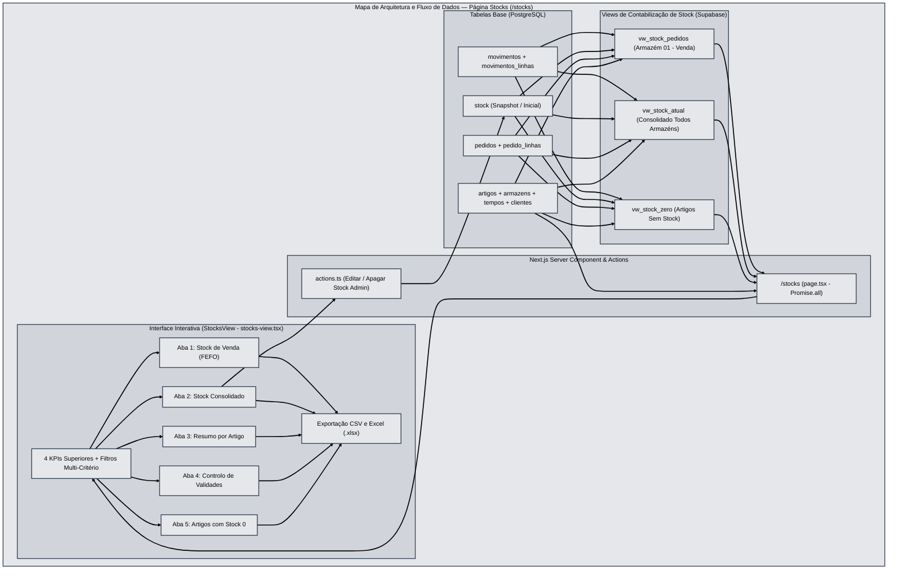

# Documentação Funcional e Técnica — Módulo de Gestão de Stocks

**Projeto:** PlatFarmaSupa (Sermail)  
**Rota abrangida:** `/stocks`

---

## 1. Visão Geral

O módulo de **Stocks** (`/stocks`) centraliza o controlo físico, comercial e regulamentar do inventário farmacêutico e logístico na plataforma **PlatFarmaSupa**. Permite consultar em tempo real o stock disponível para venda (Armazém `01`), o stock consolidado em todos os estados de armazém (Quarentena, Devoluções, Expirados, Danificados, etc.), o resumo agregado por artigo, o controlo FEFO (*First Expired, First Out*) de validades parametrizado por cliente e a monitorização de referências com rotura total (**Stock 0**).

### Arquitetura e Fluxo de Dados

### Arquitetura de Ficheiros
| Ficheiro | Função Principal |
| :--- | :--- |
| `src/app/stocks/page.tsx` | *Server Component* da rota `/stocks`; autentica o utilizador via `getAuthContext()`, aplica o isolamento por cliente (`userClientId`) e carrega em paralelo (`Promise.all`) as *views* `vw_stock_atual`, `vw_stock_pedidos`, `vw_stock_zero`, `clientes` e `tempos`. |
| `src/app/stocks/stocks-view.tsx` | *Client Component* principal de visualização, filtragem multi-critério, ordenação dinâmica por colunas (`Intl.Collator`), cálculo dos 4 KPIs de topo, comutação instantânea entre as 5 abas e exportação para CSV / Excel (`.xlsx`). |
| `src/app/stocks/actions.ts` | *Server Actions* restritas ao perfil `admin` (`editarLinhaStockAction` e `apagarLinhaStockAction`) para manutenção direta de registos na tabela `public.stock`, com invalidação automática de cache (`revalidatePath`). |
| `supabase/migrations/20261102102500_pedidos_stock_handoff_to_movimentos_on_processar.sql` | Definição SQL das *views* de cálculo de stock (`vw_stock_atual`, `vw_stock_pedidos` e `vw_stock_zero`) e da regra de transição (*handoff*) entre `pedidos` e `movimentos`. |

---

## 2. Motor de Contabilização de Stock (Regras de Negócio SQL)

As *views* `public.vw_stock_atual`, `public.vw_stock_pedidos` e `public.vw_stock_zero` calculam o saldo de cada artigo e lote combinando três fontes de dados em tempo real:

$$\text{Stock Lote} = \sum \text{Entradas}_{\text{movimentos}} - \sum \text{Saídas}_{\text{movimentos}} + \text{Stock Inicial}_{\text{snapshot}} - \sum \text{Reservas Ativas}_{\text{pedidos}}$$

1. **Movimentos de Armazém (`public.movimentos` + `public.movimentos_linhas`)**:
   - **Entradas (`ES`, `ET`, `E`)**: Somam positivamente (`+quantidade`) ao lote e armazém respetivo.
   - **Saídas (`SS`, `ST`, `S`)**: Abatem (`-quantidade`) ao lote e armazém respetivo.
2. **Snapshot de Stock (`public.stock`)**:
   - Utilizado como base de saldo para clientes que ainda não possuem movimentos de entrada (`ES`/`ET`) registados em `movimentos_linhas`.
3. **Dedução de Pedidos Ativos e Regra de Transição (*Handoff*) (`public.pedidos` + `public.pedido_linhas`)**:
   - Todo o pedido com `stock = true` e `status <> 'cancelado'` abate imediatamente (`-quantidade`) ao stock do **Armazém 01 (Venda)** através da tabela `pedidos`.
   - **Regra de Handoff Primavera (`processar = true`)**: Assim que o pedido tem o campo `processar = true` assinalado **e** existe na tabela `public.movimentos` um movimento cujo `documento_ref` coincide com o `doc_primavera` do pedido, o pedido **deixa de ser deduzido pela tabela `pedidos`** e passa a ser contabilizado **exclusivamente pela tabela `movimentos`**, evitando qualquer dupla dedução de stock.

---

## 3. Indicadores Superiores (4 Cartões de KPI)

No topo da página `/stocks` são calculados 4 indicadores operacionais numa única passagem $O(N)$ sobre `vw_stock_atual`:

| # | Indicador (KPI) | Regra de Negócio / Critério | Significado Operacional |
| :-: | :--- | :--- | :--- |
| **1** | **Stock Outros Armazéns** | $\sum \text{stock}$ onde `tipo_armazem <> '01'` | Total de unidades fora do circuito comercial (Quarentena `05`, Devoluções `04`, Expirados `02`, Danificados `03`, Destruição `06`, Farmacoteca `07`, Validade `09`, MIA `10`). |
| **2** | **Alertas Validade DM** *(Dispositivos Médicos)* | Contagem de `artigo_id` distintos do tipo `DM` com $\text{dias até validade} \le 0$. | Dispositivos médicos com lote já expirado em armazém. |
| **3** | **Alertas Validade DC e SA** *(Dermocosméticos e Suplementos)* | Contagem de `artigo_id` distintos dos tipos `DC` ou `SA` com $\text{dias até validade} \le 0$. | Dermocosméticos e suplementos alimentares expirados em armazém. |
| **4** | **Alertas Validade MH** *(Medicamentos de Uso Humano)* | Contagem de `artigo_id` distintos do tipo `MH` com $\text{dias até validade} < 180\text{ dias}$. | Medicamentos humanos em janela regulamentar de risco de caducidade (inferior a 6 meses). |

---

## 4. Sistema de Pesquisa e Filtros Multi-Critério

O painel de filtragem atua transversalmente sobre as abas de stock:

1. **Pesquisa Textual Rápida**: Filtra em simultâneo por código do artigo (`artigo_id`), código cliente (`artigo_cli`), descrição (`descricao`), número de lote (`lote`), código de localização (`armazem_loc`) e sigla/nome do cliente.
2. **Filtro de Cliente**: Visível para `admin` e `gestor` (`Todos os Clientes` ou cliente específico); fixado na empresa do utilizador para perfis `user1` e `user2`.
3. **Filtro de Conservação (`tipo_armazenamento`)**:
   - `TF` — Temperatura Frio ($2\text{–}8\text{ ºC}$)
   - `TC` — Temperatura Controlada ($15\text{–}25\text{ ºC}$)
   - `TA` — Temperatura Ambiente
4. **Filtro de Tipo de Artigo (`tipo_artigo`)**:
   - `MH` (Medicamento Humano), `MV` (Medicamento Veterinário), `DM` (Dispositivo Médico), `DC` (Dermo-Cosmético), `SC` (Substância Controlada), `SA` (Suplemento Alimentar).
5. **Filtro de Tipo de Armazém (`tipo_armazem`)**:
   - `01` (Venda), `02` (Expirados), `03` (Danificados), `04` (Devoluções), `05` (Quarentena), `06` (Destruição), `07` (Farmacoteca), `09` (Validade), `10` (MIA).

---

## 5. As 5 Abas de Consulta de Stock

A navegação entre abas preserva no DOM as abas já visitadas (`visitedTabs`) para comutação instantânea e permite ordenação crescente/decrescente clicando nos cabeçalhos **Artigo** e **Descrição do Artigo**:

### 5.1 Aba 1 — Stock de Venda (`vw_stock_pedidos`)
- Apresenta exclusivamente os lotes alojados no **Armazém `01` (Venda Livre)** com saldo positivo (`stock > 0`), disponíveis para alocação imediata na criação de pedidos.
- **Destaque de Limiar Parametrizado (`tempos`)**: Cruza cada linha com os limiares definidos para o cliente na tabela `public.tempos` (`VAL_MH`, `VAL_MV`, `VAL_DM`, `VAL_DC`, `VAL_SA`). Se os dias restantes até à validade forem iguais ou inferiores ao limiar do cliente ($\text{dias} \le \text{VAL\_TIPO}$), a linha é destacada a âmbar.

### 5.2 Aba 2 — Stock Consolidado (`vw_stock_atual`)
- Mostra todos os lotes com saldo positivo distribuídos por **todos os armazéns** (`01` a `10`), identificando `armazem_loc`, `tipo_armazem` e a descrição do armazém.
- **Modo Administrador (`isAdmin`)**: Nos perfis de administração, cada linha disponibiliza botões para **Editar** (`editarLinhaStockAction`) ou **Apagar** (`apagarLinhaStockAction`) o registo de stock correspondente.

### 5.3 Aba 3 — Resumo por Artigo (`resumoArtigos`)
- Agrega todos os lotes de cada referência (`cliente_id + artigo_id`) numa linha única, discriminando:
  - **Stock Venda (`01`)**: Unidades disponíveis para expedição comercial;
  - **Stock Outros (`<> 01`)**: Unidades retidas noutros armazéns;
  - **Stock Total**: Soma global ($\text{Stock Venda} + \text{Stock Outros}$);
  - **N.º de Lotes Distintos** e **Primeira Validade (FEFO)**.

### 5.4 Aba 4 — Controlo de Validades (`lotesValidade`)
- Lista todos os lotes com data de validade atribuída, ordenados por defeito segundo a regra **FEFO** (*First Expired, First Out* — validade mais próxima no topo).
- Calcula os **Dias Restantes** ($\lceil(\text{Validade} - \text{Hoje}) / 86\,400\,000\rceil$) e classifica o estado de cada lote consoante os tempos parametrizados por cliente e tipologia de artigo (**Expirado**, **Bloqueado / Alerta** ou **Conforme**).

### 5.5 Aba 5 — Artigos com Stock 0 (`vw_stock_zero`)
- Identifica todas as referências do catálogo do cliente (`public.artigos`) ou com histórico de movimentos cujo saldo total atual em armazém é **zero** ($\sum \text{stock} \le 0$).
- **Regra de Exclusão ao Nível do Artigo**: O lote é ignorado — se um artigo tiver stock positivo em qualquer lote ou armazém (`artigosComStockPositivo`), nunca é listado como Stock 0. Mostra também a data do **Último Movimento** e o **Total de Movimentos** históricos.

---

## 6. Exportação de Dados (CSV e Excel `.xlsx`)

Os botões de exportação no topo da página exportam exatamente a vista e os filtros ativos na aba selecionada:
- **Exportação CSV**: Gera um ficheiro `.csv` codificado em `UTF-8 com BOM (\uFEFF)` para abertura direta no Microsoft Excel com acentuação portuguesa preservada.
- **Exportação Excel (`.xlsx`)**: Carrega dinamicamente a biblioteca `ExcelJS` (`await import('exceljs')`) e gera uma folha de cálculo nativa formatada com cabeçalho institucional verde-floresta Sermail (`#1B4332`), larguras de coluna ajustadas e formatação numérica/datas localizada (`pt-PT`).

