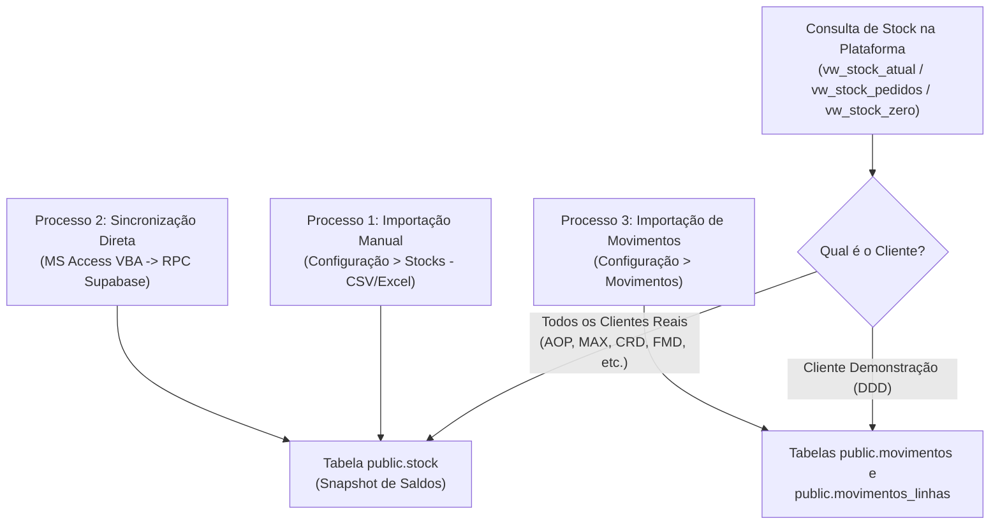

# Documentação Técnica e Operacional — Processos de Importação de Stock

Esta documentação descreve a arquitetura de armazenamento de saldos de stock na plataforma **PlatFarmaSupa** e os procedimentos disponíveis para atualizar a tabela `public.stock`.

---

## 1. Arquitetura Geral do Stock na Plataforma

As vistas (*Views*) que alimentam as páginas de **Stocks**, **Dashboard (Previsão e Alertas)** e **Novo Pedido** (`public.vw_stock_atual`, `public.vw_stock_pedidos` e `public.vw_stock_zero`) utilizam uma **regra híbrida de origem de dados**:



> [!IMPORTANT]
> Para todos os clientes reais (exceto o cliente de demonstração `DDD`), a tabela **`public.stock`** funciona como uma **fotografia (*snapshot*) do stock atual**. Sempre que é atualizada, os saldos anteriores são limpos e substituídos pelos novos saldos para evitar a acumulação de lotes já esgotados.

---

## 2. Estrutura da Tabela `public.stock`

A tabela `public.stock` no PostgreSQL (Supabase) possui a seguinte estrutura:

| Coluna | Tipo de Dados | Obrigatório | Descrição / Regra de Preenchimento |
| :--- | :--- | :---: | :--- |
| `id` | `uuid` (PK) | Sim (Auto) | Gerado automaticamente (`gen_random_uuid()`) ou lido do ficheiro (se enviado com ou sem `{}`). |
| `cliente_ser` | `text` | **Sim** | Sigla do cliente na Sermail (ex.: `AOP`, `MAX`, `CRD`). |
| `entidade` | `text` | Não | Código do cliente no Primavera/ERP (ex.: `6159`, `482`). Corresponde a `clientes.cli_primavera`. |
| `sigla` | `text` | Não | Sigla do cliente (idêntica a `cliente_ser`). |
| `artigo_id` | `text` | **Sim** | Código do artigo (ex.: `5781356`). Aceita também o alias `artigo` na importação. |
| `descricao` | `text` | Não | Designação comercial do artigo. |
| `armazem` | `text` | **Sim** | Código do armazém (ex.: `AOP01`, `AOP05`, `AOP06`). |
| `localizacao` | `text` | Não | Código da localização física / posição (ex.: `AOP01.14B35`). |
| `lote` | `text` | Não | Código do lote farmacêutico (ex.: `TREP2243`). |
| `stock` | `numeric` | **Sim** | Quantidade em stock atual (predefinido `0`). |
| `data_stock` | `date` | Não | Data de referência do saldo ou da entrada do lote. |
| `validade` | `date` | Não | Data de validade do lote (`YYYY-MM-DD`). |
| `data_fabrico` | `date` | Não | Data de fabrico do lote (`YYYY-MM-DD`). Datas sentinela `1980-01-01` são convertidas em `NULL`. |
| `created_at` | `timestamptz` | Sim (Auto) | Data/hora de criação do registo na tabela (`now()`). |

---

## 3. Processo 1 — Importação Manual por Ficheiro (`Configuração > Stocks`)

Este processo permite a qualquer utilizador com perfil **Administrador** ou **Gestor** carregar um ficheiro exportado do MS Access ou Excel diretamente através da interface web.

### 3.1. Ficheiros de Código Envolvidos
- **Componente de Interface**: [importacao-stock-tab.tsx](file:///c:/1-Projetos_IA/Projetos_Antigravity/PlatFarmaSupa/src/app/configuracao/importacao-stock-tab.tsx)
- **Leitor e Normalizador de Ficheiros**: [parse-stock-file.ts](file:///c:/1-Projetos_IA/Projetos_Antigravity/PlatFarmaSupa/src/lib/parse-stock-file.ts)
- **Server Actions**: [`importarStockAction`](file:///c:/1-Projetos_IA/Projetos_Antigravity/PlatFarmaSupa/src/app/configuracao/actions.ts#L1031-L1112) e [`limparStockAction`](file:///c:/1-Projetos_IA/Projetos_Antigravity/PlatFarmaSupa/src/app/configuracao/actions.ts#L1115-L1157) em [actions.ts](file:///c:/1-Projetos_IA/Projetos_Antigravity/PlatFarmaSupa/src/app/configuracao/actions.ts)

### 3.2. Formatos e Cabeçalhos Suportados
O parser [`parseStockFile`](file:///c:/1-Projetos_IA/Projetos_Antigravity/PlatFarmaSupa/src/lib/parse-stock-file.ts#L384-L414) suporta ficheiros **`.xlsx`**, **`.xls`**, **`.csv`** (delimitados por `;`, `,` ou `TAB`) e **`.txt`**.
Os cabeçalhos são reconhecidos independentemente de maiúsculas/minúsculas ou acentuação:

| Campo na Tabela `stock` | Nomes de Coluna Aceites no Ficheiro (Excel / CSV) |
| :--- | :--- |
| `id` | `id`, `uuid`, `id_stock`, `stock_id`, `pk` *(opcional — se omitido, é gerado um UUID)* |
| `cliente_ser` | `cliente_ser`, `clienteser`, `cod_cliente`, `cliente` *(ou preenchido via seletor "Cliente Predefinido")* |
| `entidade` | `entidade`, `cod_entidade`, `codigo_entidade`, `cliente_entidade`, `cli_primavera` |
| `sigla` | `sigla`, `sigla_cliente`, `cliente_sigla` |
| `artigo_id` | `artigo`, `artigo_id`, `artigoid`, `cod_artigo`, `codigo_artigo`, `produto`, `sku` |
| `descricao` | `descricao`, `descrição`, `desc_artigo`, `nome_artigo`, `designacao`, `designação` |
| `armazem` | `armazem`, `armazém`, `cod_armazem`, `warehouse`, `deposito` |
| `localizacao` | `localizacao`, `localização`, `posicao`, `posição`, `loc`, `bin` |
| `lote` | `lote`, `num_lote`, `batch`, `lot` |
| `stock` | `stock`, `qtd`, `quantidade`, `saldo`, `existencia`, `stock_atual`, `qty` |
| `data_stock` | `data_stock`, `datastock`, `data`, `data_saldo`, `data_registo`, `data_atualizacao` |
| `validade` | `validade`, `data_validade`, `datavalidade`, `expiracao`, `val`, `expiry_date` |
| `data_fabrico` | `data_fabrico`, `datafabrico`, `fabrico`, `dt_fabrico`, `mfg_date` |

### 3.3. Fluxo de Execução Passo-a-Passo
1. **Seleção do Ficheiro**: O utilizador acede a **Configuração > Stocks** e seleciona o ficheiro `.xlsx` ou `.csv` (podendo descarregar os modelos de exemplo nos botões **Modelo CSV** ou **Modelo Excel**).
2. **Validação e Pré-visualização**:
   - O ficheiro é analisado no browser por [`parseStockFile`](file:///c:/1-Projetos_IA/Projetos_Antigravity/PlatFarmaSupa/src/lib/parse-stock-file.ts#L384-L414);
   - As datas em formato português (`DD/MM/YYYY`), ISO (`YYYY-MM-DD`) ou serial numérico do Excel são convertidas para `YYYY-MM-DD`;
   - São apresentados os indicadores de resumo (*Total Linhas*, *Qtd Total Stock*, *Clientes*, *Artigos Únicos* e *Armazéns*) e a grelha de pré-visualização.
3. **Confirmação e Gravação em Lotes**:
   - Ao clicar em **Confirmar Importação**, a função [`handleConfirmImport`](file:///c:/1-Projetos_IA/Projetos_Antigravity/PlatFarmaSupa/src/app/configuracao/importacao-stock-tab.tsx#L133-L188):
     1. Invoca [`limparStockAction()`](file:///c:/1-Projetos_IA/Projetos_Antigravity/PlatFarmaSupa/src/app/configuracao/actions.ts#L1115-L1157) **uma única vez** para limpar os registos antigos de `public.stock`;
     2. Divide os novos registos em lotes (*chunks*) de **500 linhas** e envia cada lote sequencialmente para [`importarStockAction`](file:///c:/1-Projetos_IA/Projetos_Antigravity/PlatFarmaSupa/src/app/configuracao/actions.ts#L1031-L1112);
     3. Revalida a cache das rotas `/configuracao` e `/stocks`.

---

## 4. Processo 2 — Sincronização Direta a partir do MS Access (VBA -> RPC Supabase)

Este processo permite atualizar a tabela `public.stock` diretamente a partir de uma **Query do MS Access** com um clique num botão de formulário (ou macro), sem necessidade de exportar ficheiros intermédios.

### 4.1. Ficheiros de Código Envolvidos
- **Módulo VBA para MS Access**: [access_sync_stock.bas](file:///c:/1-Projetos_IA/Projetos_Antigravity/PlatFarmaSupa/scripts/access_sync_stock.bas)
- **Migração e Funções RPC no Supabase**: [20261029203000_create_sync_stock_from_access_rpc.sql](file:///c:/1-Projetos_IA/Projetos_Antigravity/PlatFarmaSupa/supabase/migrations/20261029203000_create_sync_stock_from_access_rpc.sql)
  - Função RPC principal: `public.sync_stock_from_access(p_rows jsonb, p_limpar_tudo boolean, p_limpar_clientes boolean)`
  - Função auxiliar de datas: `public.fn_parse_access_date(p_val text, p_ignore_1980 boolean)`

### 4.2. Funcionamento Transacional da RPC `public.sync_stock_from_access`
Quando o MS Access envia o resultado da query em formato JSON para `/rest/v1/rpc/sync_stock_from_access`, o PostgreSQL executa **tudo dentro de uma única transação atómica**:
1. **Normalização de Campos e Datas**:
   - Lê os campos independentemente de maiúsculas/minúsculas (`cliente_ser`/`Sigla`, `Entidade`/`cli_primavera`, `artigo`/`artigo_id`, `descricao`, `armazem`, `localizacao`, `lote`, `stock`/`quantidade`, `data_stock`, `data_fabrico`, `validade`);
   - Converte números com vírgula ou ponto decimal e datas nos formatos `YYYY-MM-DD` ou `DD/MM/YYYY` (convertendo `1980-01-01` em `NULL` no campo `data_fabrico`).
2. **Associação Automática a `public.clientes`**:
   - Mesmo que a query do MS Access envie apenas a `Entidade` (ex.: `6159`) ou apenas a `Sigla` (ex.: `AOP`), a função cruza com `public.clientes` para preencher automaticamente `cliente_ser`, `sigla` e `entidade`.
3. **Substituição Atómica do Stock Anterior**:
   - Se `p_limpar_tudo = true`: limpa toda a tabela `public.stock`;
   - Se `p_limpar_tudo = false` (predefinido) e `p_limpar_clientes = true`: limpa apenas o stock anterior dos clientes (`cliente_ser`) presentes nos dados enviados;
   - Insere de seguida todos os novos registos. Se ocorrer qualquer erro, a transação faz *rollback* automático e os dados anteriores permanecem intactos.

### 4.3. Como Configurar no MS Access
1. No MS Access, premir **`Alt + F11`** para abrir o editor de Visual Basic for Applications (VBA).
2. Aceder a **File (Ficheiro) > Import File (Importar Ficheiro...)** e selecionar o ficheiro [access_sync_stock.bas](file:///c:/1-Projetos_IA/Projetos_Antigravity/PlatFarmaSupa/scripts/access_sync_stock.bas).
3. No topo do módulo `modSyncStockSupabase`, ajustar o nome predefinido da query se necessário:
   ```vba
   Private Const NOME_QUERY_PADRAO As String = "qry_Stock_Supabase"
   ```
4. No evento **Ao Clicar (*On Click*)** de um botão no formulário do MS Access, colocar:
   ```vba
   ' Substitui o stock dos clientes devolvidos pela query:
   Call AtualizarStockSupabase("qry_Stock_Supabase", False)

   ' Ou, para limpar toda a tabela public.stock antes de inserir o resultado da query:
   Call AtualizarStockSupabase("qry_Stock_Supabase", True)
   ```

---

## 5. Resumo Comparativo dos Métodos

| Característica | Processo 1: Ficheiro Web (`Configuração > Stocks`) | Processo 2: MS Access Direto (`VBA -> RPC`) |
| :--- | :--- | :--- |
| **Origem dos Dados** | Ficheiro `.xlsx`, `.xls`, `.csv` ou `.txt` | Query direta no MS Access (`DAO.Recordset`) |
| **Intervenção Manual** | Exportar ficheiro + Upload na página de Configuração | 1 Clique num botão dentro do MS Access |
| **Limpeza Prévia** | Limpa a tabela no início via [`limparStockAction`](file:///c:/1-Projetos_IA/Projetos_Antigravity/PlatFarmaSupa/src/app/configuracao/actions.ts#L1115-L1157) | Transacional na BD por cliente ou tabela completa |
| **Pré-visualização** | Sim (grelha interativa e estatísticas antes de gravar) | Confirmação imediata por `MsgBox` no Access |

