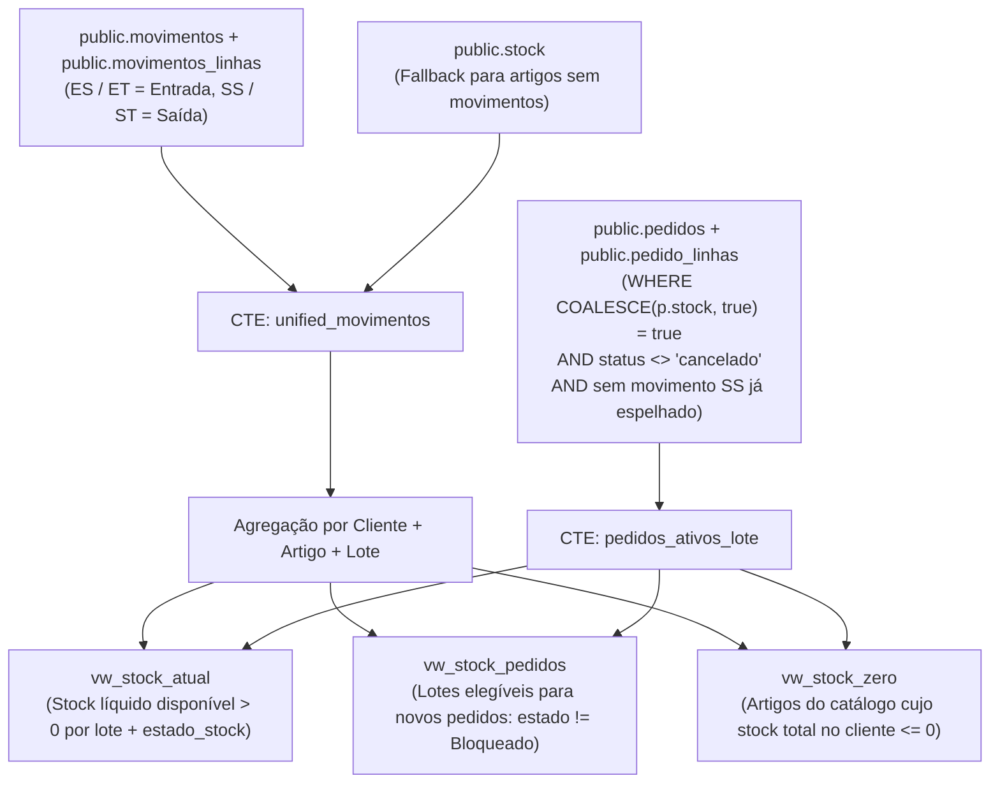

# Catálogo de Views — Base de Dados Supabase (`public`)

Todas as views do esquema `public` têm `security_invoker = true` ativado para respeitar rigorosamente as políticas RLS do utilizador autenticado.

---

## 1. Views Unificadas de Stock (Migração `20261101185500_unify_stock_views_all_clients_from_movimentos.sql`)

O cálculo de stock para **todos os clientes (reais e demo `DDD`)** segue a mesma arquitetura dinâmica baseada nos movimentos (`movimentos` + `movimentos_linhas`, com fallback para `public.stock` caso o artigo não tenha movimentos diretos) e deduzindo todos os pedidos ativos marcados com `pedidos.stock = true`.

### 1.1 `public.vw_stock_atual`
Apresenta o stock líquido atual (`stock > 0`) por lote, artigo e cliente, classificando automaticamente a validade de acordo com a tabela `tempos` (ou 180 dias para Medicamentos de Uso Humano `MH` / 60 dias de bloqueio).

- **Colunas:** `stock_id`, `cliente_id`, `cliente_nome`, `cliente_sigla`, `artigo_id`, `artigo_cli`, `tipo_artigo`, `lote`, `validade`, `data_ultima_entrada`, `stock`, `estado_stock` (`'Disponível'`, `'Em Risco'`, `'Bloqueado'`), `descricao`.
- **Onde é usada:** `/stocks`, `/dashboard`, `/dashboard/previsao-stock`.

### 1.2 `public.vw_stock_pedidos`
Apresenta os lotes com stock líquido disponível (`stock > 0`) e cujo estado de validade **não seja `'Bloqueado'`** (validade nula ou superior ao limite de bloqueio de 60 dias), prontos a serem selecionados no formulário de Novo Pedido.

- **Colunas:** `cliente_id`, `cliente_nome`, `cliente_sigla`, `artigo_id`, `artigo_cli`, `descricao`, `tipo_artigo`, `lote`, `validade`, `stock`, `estado_stock`.
- **Onde é usada:** `/pedidos` (`NovoPedidoForm`), `/Proc_Pedidos` (`ProcPedidosView`).

### 1.3 `public.vw_stock_zero`
Lista os artigos ativos do catálogo (`public.artigos`) cujo saldo líquido total (soma de todos os lotes em `unified_movimentos` menos todos os pedidos ativos com `stock = true`) é igual ou inferior a `0`.

- **Colunas:** `cliente_id`, `cliente_nome`, `cliente_sigla`, `artigo_id`, `artigo_cli`, `descricao`, `tipo_artigo`, `lote` (`'SEM STOCK'`), `validade` (`NULL`), `data_ultima_saida`, `stock` (`0`), `estado_stock` (`'Sem Stock'`).
- **Onde é usada:** `/stocks` (aba *Artigos sem Stock*).

---

## 2. Views de Analítica, Pedidos e Expedição

### 2.1 `public.vw_pedidos`
 Agrega cabeçalhos de pedidos e saídas com o array JSON `pedido_linhas`, total de linhas e quantidade total para alimentar o Dashboard e a Previsão de Stock.

- **Colunas:** `id`, `documento_ref`, `cliente_id`, `data_pedido`, `created_at`, `total_linhas`, `total_quantidade`, `sigla`, `nome`, `entidade`, `tipo_doc`, `pedido_linhas`.

### 2.2 `public.vw_saidas`
Lista todos os movimentos de saída (`SS`) com informação do artigo (`artigo_id`, `artigo_cli`, `descricao`, `tipo_desc`), cliente e quantidade para o cálculo do **Top 10 Produtos Expedidos**.

### 2.3 `public.vw_fact_mes`
Agrega a faturação mensal por cliente (`sigla_cliente`, `cliente_id`, `data`, `total_docs`, `total_quantidade`, `total_merc`, `total_iva`, `total_desc`, `total_liquido`) a partir da tabela `public.faturas` (contabilizando diretamente valores de Notas de Crédito).

### 2.4 `public.VW_torrestir_last`
Retorna o registo de tracking mais recente por `ref_ser` da tabela `public.torrestir_status`, incluindo `desc_estado_expedicao` e `url_comprovativo`.

