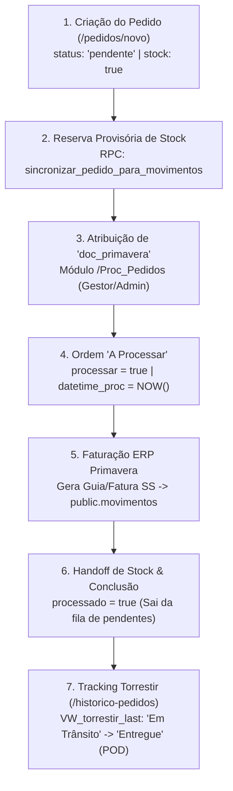

# Ciclo de Vida e Lógica de Estados: Pedidos, Movimentos e Rastreio

**Projeto:** PlatFarmaSupa (Sermail)  
**Módulos abrangidos:** `/pedidos/novo`, `/Proc_Pedidos` e `/historico-pedidos`  
**Diagrama Visual:** [mapa_fluxo_pedido_movimento.svg](file:///C:/Users/joaom/.gemini/antigravity/brain/68759e4d-57ed-4be2-abe7-3e139dcca28d/mapa_fluxo_pedido_movimento.svg)

---

## 1. Diagrama Geral do Ciclo de Vida

---

## 2. Detalhe Passo a Passo das 7 Etapas

### Etapa 1: Criação do Pedido (`/pedidos/novo`)
- **Quem executa:** Cliente autenticado ou Gestor/Admin em seu nome.
- **Tabelas afetadas:** `public.pedidos` (cabeçalho) e `public.pedido_linhas` (artigos e quantidades).
- **Valores atribuídos:**
  - `status = 'pendente'`
  - `tipo_movimento = 'SS'` (*Saída de Stock*)
  - `stock = true` *(por defeito: ativa a reserva de existências)*
  - `doc_primavera = null`
  - `processar = false`
  - `processado = false`

### Etapa 2: Reserva Provisória de Stock
- **Mecanismo:** Invocação da RPC PostgreSQL `sincronizar_pedido_para_movimentos(p_pedido_id)`.
- **Efeito:** Enquanto o pedido não foi faturado no ERP Primavera, a reserva no Armazém `01` (Venda) é garantida pelas views `vw_stock_atual`, `vw_stock_pedidos` e `vw_stock_zero`, abatendo as quantidades pendentes e impedindo sobre-venda a outros clientes.
- **Cancelamento:** Se o pedido for cancelado ou se a flag `stock` for desmarcada, o stock é reposto de imediato no lote correspondente.

### Etapa 3: Validação Operacional e Documento Primavera (`/Proc_Pedidos`)
- **Quem executa:** Equipa de Logística / Gestão (`gestor` e `admin`).
- **Ação:** Inserção do número do documento gerado no ERP Primavera no campo `doc_primavera` (ex.: `ECL 2026/001` ou guia de remessa).
- **Regra de negócio crítica:** A checkbox **`Processar`** permanece **estritamente bloqueada (`disabled`)** enquanto o campo `doc_primavera` estiver vazio.

### Etapa 4: Ordem de Preparação em Armazém (`processar = true`)
- **Ação:** Com `doc_primavera` atribuído, o operador marca a checkbox `Processar`.
- **Efeitos imediatos:**
  - `processar = true`
  - `datetime_proc = new Date().toISOString()` *(carimbo de auditoria temporal com data e hora exatas)*
  - `status = 'em_preparacao'`
- **Operação de armazém:** A equipa do armazém efetua a recolha (*picking*) seguindo o critério **FEFO** (*First Expired, First Out*), embala e prepara os volumes para pesagem e recolha pela transportadora.

### Etapa 5: Faturação no ERP Primavera & Importação
- **Processamento:** O ERP Primavera emite a Guia de Remessa e Fatura oficial.
- **Sincronização:** O conector de dados importa a transação física para `public.movimentos` e as respetivas linhas de lote para `public.movimentos_linhas`.
- **Chave de ligação (*Join Key*):**
  $$\text{movimentos.documento\_ref} \equiv \text{pedidos.doc\_primavera}$$

### Etapa 6: *Handoff* de Stock & Exclusão da Fila de Pendentes
- **Passagem de testemunho (*Handoff*):**
  - O abate físico de existências no Armazém `01` passa a ser assegurado pela linha real em `public.movimentos`.
  - As views de stock deixam de deduzir o pedido pela tabela `pedidos`, evitando qualquer duplicação de desconto.
- **Marcação `processado = true`:**
  - O pedido é sinalizado como concluído.
  - **Regra de interface:** É automaticamente **removido da grelha de trabalho ativo** em `/Proc_Pedidos` e da listagem em `/historico-pedidos`, assegurando que a consulta passa a ser feita pela linha do movimento real consolidado.

### Etapa 7: Expedição, Tracking Torrestir e Comprovativo POD
- **Módulo de consulta:** `/historico-pedidos` (Menu: *Histórico de Movimentos*).
- **Cruzamento em tempo real:** A aplicação cruza a referência do movimento com a vista `public.VW_torrestir_last` pela chave normalizada `ref_ser` (ou `documento_ref`/`requisicao`).
- **Evolução do estado:**
  1. `em_preparacao` *(Em armazém Sermail)*
  2. `Em Trânsito` / `Em Distribuição` *(Na rede de distribuição da Torrestir)*
  3. `Entregue` / `Entregue PDA` *(Entregue no destino final)*
- **Comprovativo de Entrega (POD):** Se `url_comprovativo` estiver presente no estado *Entregue*, o sistema disponibiliza o botão para visualizar e descarregar o documento assinado digitalizado (conversão de TIFF para PNG em `<canvas>`).

---

## 3. Matriz de Estados e Mapeamento

| Origem do Registo | Campo Original | Valor Técnico | Estado Apresentado na Interface |
| :--- | :--- | :--- | :--- |
| **`pedidos`** (Plataforma) | `status` | `pendente` | **Pendente** |
| **`pedidos`** (Plataforma) | `status` | `confirmado` | **Confirmado** |
| **`pedidos`** (Plataforma) | `status` | `em_preparacao` | **Em Preparação** |
| **`pedidos`** (Plataforma) | `status` | `cancelado` | **Cancelado** |
| **`movimentos`** (ERP) | `tipo_movimento` | `ES` | **Rececionado** *(Entrada de Stock)* |
| **`movimentos`** (ERP) | `tipo_movimento` | `ET` ou `ST` | **Transfer** *(Transferência entre Armazéns)* |
| **`movimentos`** (ERP) | `tipo_movimento` | `SS` | **Em Preparação** *(Valor base de Saída)* |
| **Torrestir Tracking** | `desc_estado_expedicao` | `Em Trânsito` | **Em Trânsito** *(Sobrepõe o estado base)* |
| **Torrestir Tracking** | `desc_estado_expedicao` | `Entregue` / `Entregue PDA` | **Entregue** *(Ativa visualizador POD TIFF)* |
| **Torrestir Tracking** | `desc_estado_expedicao` | `Incidência` | **Incidência** |
