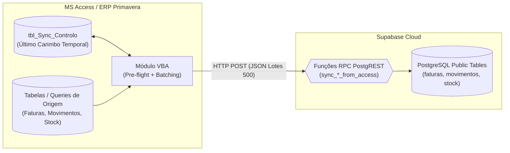
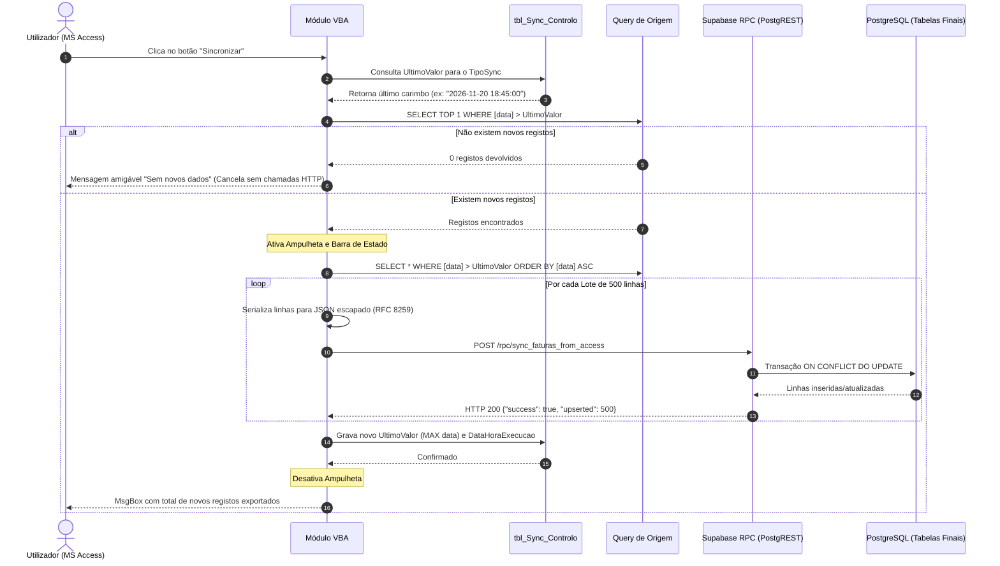
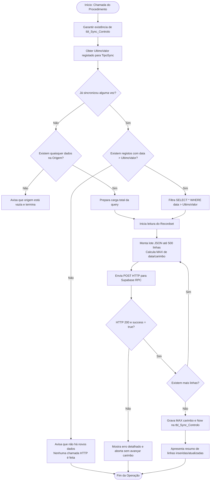

# Arquitetura e Fluxo de Sincronização Incremental (Método A)

> **Projeto:** PlatFarmaSupa (Sermail)  
> **Componente:** Módulos VBA do MS Access (`modSyncFaturasSupabase`, `modSyncMovimentosSupabase`, `modSyncStockSupabase`)  
> **Destino:** Supabase PostgreSQL (`public.faturas`, `public.movimentos`, `public.stock`)  
> **Modo:** Sincronização Incremental / Delta por Carimbo Temporal (Método A)

---

## 1. Visão Geral da Arquitetura

O **Método A** resolve o desafio de sincronização periódica entre o sistema de faturação/gestão (Primavera / MS Access) e a base de dados na cloud (Supabase), mantendo a **integridade total das tabelas de origem**:

* **Não altera tabelas ERP:** Não são adicionadas colunas (ex: flags booleanas) nem são alterados esquemas de tabelas no Primavera/Access.
* **Tabela Local de Controlo Automática:** O Access mantém localmente a tabela `tbl_Sync_Controlo` que regista para cada entidade o último carimbo temporal (`Timestamp`), o total de registos exportados e a data da operação.
* **Pre-Flight Check a Custo Zero:** Antes de inicializar o cursor de processamento e antes de enviar qualquer pedido HTTP pela rede, o módulo verifica se existem novos dados. Se nada mudou, cancela imediatamente.
* **Processamento Resiliente em Lotes:** Envio em blocos de 500 registos (`TAMANHO_LOTE`) via JSON para funções RPC transacionais com `ON CONFLICT DO UPDATE`.



---

## 2. Estrutura da Tabela Local `tbl_Sync_Controlo`

Criada automaticamente pelo VBA caso não exista na base de dados Access local:

| Campo | Tipo no Access | Descrição | Exemplo |
| :--- | :--- | :--- | :--- |
| `TipoSync` | `VARCHAR(50)` (PK) | Identificador da sincronização | `"FATURAS"`, `"MOVIMENTOS"`, `"STOCK"` |
| `UltimoValor` | `VARCHAR(100)` | Carimbo da data/hora ou ID mais recente exportado | `"2026-11-20 18:45:00"` |
| `UltimoTotalRegistos` | `LONG` | Número de linhas processadas na última execução | `124` |
| `DataHoraExecucao` | `DATETIME` | Data e hora em que a sincronização decorreu | `21/11/2026 15:10:00` |
| `Status` | `VARCHAR(50)` | Estado do resultado | `"SUCESSO"`, `"ERRO"` |

> [!NOTE]
> Esta tabela é independente de cada utilizador ou partilhada consoante o ficheiro `.accdb` esteja local ou em rede, garantindo isolamento total em relação ao motor SQL do Primavera.

---

## 3. Diagrama de Sequência da Sincronização



---

## 4. Fluxograma Detalhado de Decisão



---

## 5. Componentes e Funções Chave nos Módulos

Os 3 ficheiros atualizados no diretório do projeto:
* `scripts/access_sync_faturas.bas`
* `scripts/access_sync_movimentos.bas`
* `scripts/access_sync_stock.bas`

### Assinaturas Principais

```vba
' 1. Verificação prévia rápida sem chamadas de rede:
Public Function ExistemNovosRegistosFaturas( _
    Optional ByVal NomeOrigem As String = "qry_Faturas_Supabase", _
    Optional ByVal CampoDataOuID As String = "data", _
    Optional ByVal TipoSync As String = "FATURAS", _
    Optional ByVal NomeTabelaControlo As String = "tbl_Sync_Controlo" _
) As Boolean

' 2. Procedimento de sincronização com controlo incremental:
Public Sub AtualizarFaturasSupabase( _
    Optional ByVal NomeQuery As String = "qry_Faturas_Supabase", _
    Optional ByVal LimparTodaTabela As Boolean = False, _
    Optional ByVal LimparClientesEnviados As Boolean = False, _
    Optional ByVal AtualizarExistentes As Boolean = True, _
    Optional ByVal MostrarMensagem As Boolean = True, _
    Optional ByVal ApenasNovosRegistos As Boolean = True, _
    Optional ByVal CampoDataOuID As String = "data" _
)

' 3. Função de Reinicialização (permite forçar re-envio completo quando necessário):
Public Sub ResetControloFaturas( _
    Optional ByVal TipoSync As String = "FATURAS", _
    Optional ByVal NomeTabelaControlo As String = "tbl_Sync_Controlo" _
)
```

---

## 6. Procedimento de Recuperação e Reset

Se por alguma razão administrativa for necessário **re-enviar todo o histórico** desde o início:
1. Abra a janela imediata do VBA (`CTRL + G` no editor de VBA).
2. Execute o comando de reset para a entidade desejada:
   ```vba
   Call ResetControloFaturas
   ' ou
   Call ResetControloMovimentos
   ' ou
   Call ResetControloStock
   ```
3. Na sincronização seguinte, o VBA deteta a ausência de carimbo e sincroniza a totalidade dos registos disponíveis na query de origem.
