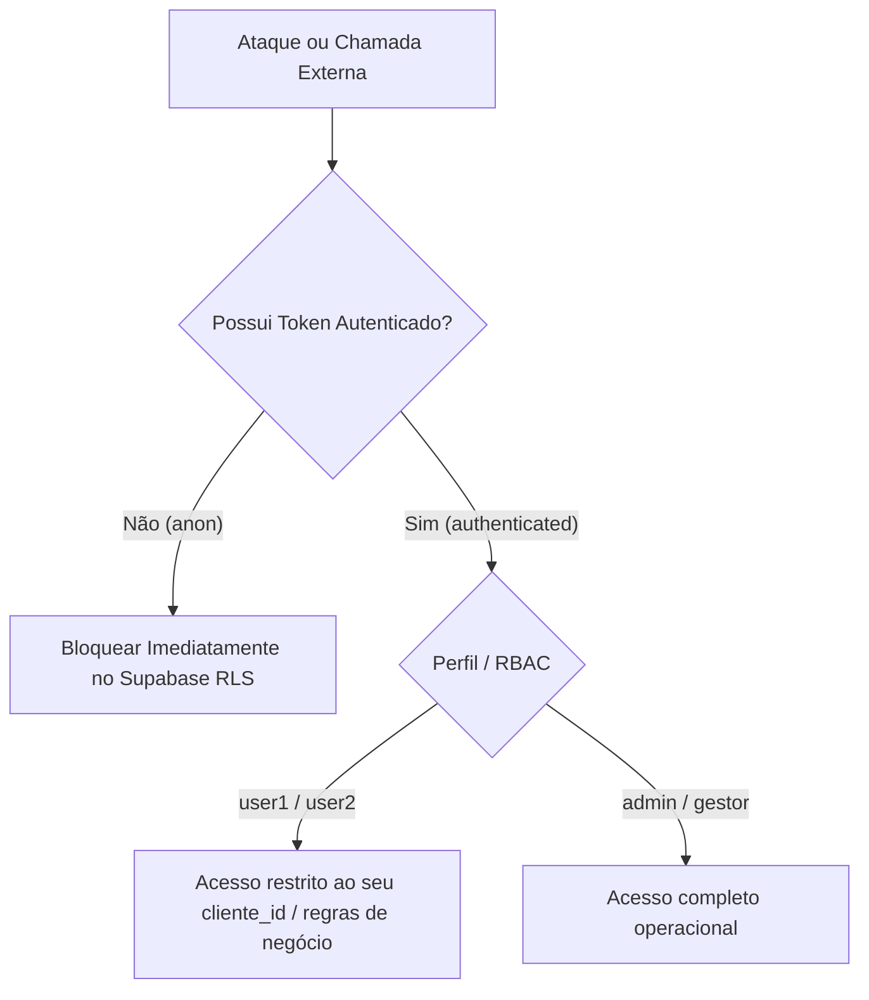

# Relatório de Auditoria de Segurança da Aplicação

> **Data da Auditoria:** 20 de Novembro de 2026  
> **Âmbito:** Controlo de acessos, Row Level Security (RLS) na base de dados Supabase, Proteção de Rotas e Segurança de Chaves de API (`.env.local` / Frontend).  
> **Classificação Global de Risco:** 🚨 **CRÍTICO** (Necessita de intervenção imediata nas políticas da base de dados).

---

## 1. Resumo Executivo

A auditoria de segurança incidiu sobre três vetores fundamentais:
1. **Segurança das API Keys e Variáveis de Ambiente:** Exposição de chaves no bundle de frontend e fuga de segredos de backend.
2. **Proteção de Rotas e Controlo de Sessão (Frontend / SSR):** Tentativas de acesso direto por utilizadores anónimos ou com perfis não autorizados às páginas da aplicação.
3. **Row Level Security (RLS) na Base de Dados (Supabase PostgreSQL):** Validação real de permissões simulando chamadas anónimas diretas à API REST do Supabase (`PostgREST`).

**Conclusão Principal:** Embora o frontend e as páginas SSR Next.js bloqueiem visualmente o utilizador não autenticado (redirecionando para `/login`), **a base de dados Supabase tem políticas RLS abertas ao público (`anon`)**, permitindo que qualquer pessoa com acesso à chave pública da aplicação descarregue todas as **faturas (dados financeiros)** e tenha permissões totais (`SELECT`, `INSERT`, `UPDATE`, `DELETE`) nas tabelas de **artigos, stock e movimentos**.

---

## 2. Avaliação de Segurança das API Keys

| Chave / Variável | Localização | Visibilidade no Cliente | Estado de Segurança | Avaliação |
| :--- | :--- | :--- | :--- | :--- |
| `NEXT_PUBLIC_SUPABASE_URL` | `.env.local` / Bundle JS | **Pública** (por desenho) | ⚠️ Requer RLS rigoroso | Normal no ecossistema Supabase, mas expõe o endpoint da base de dados. |
| `NEXT_PUBLIC_SUPABASE_ANON_KEY` | `.env.local` / Bundle JS | **Pública** (por desenho) | ⚠️ Requer RLS rigoroso | Chave pública anónima. Foi concebida para ser pública **apenas se** as políticas RLS na BD estiverem devidamente trancadas. |
| `RESEND_API_KEY` | `.env.local` | **Privada** (Apenas Servidor) | 🟢 **Segura** | Não tem prefixo `NEXT_PUBLIC_`. Validado no código: a chave bruta nunca é enviada ao navegador; o ecrã de configurações apenas recebe a máscara `re_xxxx...`. |
| `SUPABASE_SERVICE_ROLE_KEY` | - | **Inexistente no Cliente** | 🟢 **Segura** | Não se encontra exposta nem presente no repositório/código-fonte. |

> [!WARNING]
> No modelo de segurança do Supabase, a chave `anon` **não é uma password secreta**. Ela é enviada em todas as requisições do browser. A verdadeira barreira de segurança reside **exclusivamente nas políticas de RLS (Row Level Security)** da base de dados PostgreSQL.

---

## 3. Resultados dos Testes de Intrusão / Acesso à Base de Dados (RLS)

Efetuámos testes diretos simulando um atacante externo que extrai a `anon_key` do browser e invoca a API do Supabase com o perfil `anon`:

```sql
SET LOCAL ROLE anon;
```

### Matriz de Testes por Tabela

| Tabela | RLS Ativo? | Acesso com Role `anon` | Linhas Obtidas | Risco Identificado |
| :--- | :---: | :---: | :---: | :--- |
| `users` | Sim | Bloqueado | 0 | 🟢 Conforme (Protegido) |
| `clientes` | Sim | Bloqueado | 0 | 🟢 Conforme (Protegido) |
| `pedidos` | Sim | Bloqueado | 0 | 🟢 Conforme (Protegido) |
| `movimentos` | Sim | Bloqueado | 0 | 🟢 Conforme (Protegido) |
| **`faturas`** | Sim | **Leitura Total Permitida** | **2.426 faturas** | 🚨 **CRÍTICO**: Fuga de dados financeiros e faturação de clientes. |
| **`artigos`** | Sim | **Acesso Total (`ALL`)** | **987 artigos** | 🚨 **CRÍTICO**: Anónimos podem ler, criar, alterar preços e apagar artigos. |
| **`stock`** | Sim | **Acesso Total (`ALL`)** | **Todas as linhas** | 🚨 **CRÍTICO**: Anónimos podem viciar ou apagar todo o inventário de stock. |
| **`plat_movimentos`** | Sim | **Acesso Total (`ALL`)** | **Todas as linhas** | 🚨 **CRÍTICO**: Anónimos podem manipular ou apagar histórico de movimentos. |
| **`configuracoes`** | Sim | **Leitura Permitida** | **2 linhas** | 🟡 **MÉDIO**: Exposição de configurações do sistema (ex: timeouts, e-mails). |

---

## 4. Detalhe Técnico das Vulnerabilidades Identificadas

### 4.1. [CRÍTICO] Fuga de Dados Financeiros (`faturas`)
* **Mecanismo:** A política `"Permitir leitura de faturas a utilizadores autenticados"` está associada aos papéis `anon, authenticated, service_role`. A função de validação interna `public.can_read_fatura()` continha:
  ```sql
  IF auth.uid() IS NULL THEN
    RETURN true; -- Permite anon!
  END IF;
  ```
* **Impacto:** Um utilizador anónimo consegue extrair a lista completa de faturação com clientes, valores e datas via simples chamada HTTP `GET /rest/v1/faturas`.

### 4.2. [CRÍTICO] Acesso Total Anónimo a `artigos`, `stock` e `plat_movimentos`
* **Mecanismo:** Foram identificadas no catálogo `pg_policies` políticas permissivas criadas anteriormente para desenvolvimento/testes:
  * `"Acesso total a artigos para anon"` (Command: `ALL`, Qual: `true`)
  * `"Acesso total a stock para anon"` (Command: `ALL`, Qual: `true`)
  * `"Acesso total a plat_movimentos para anon"` (Command: `ALL`, Qual: `true`)
* **Impacto:** Qualquer pessoa na internet pode enviar uma requisição `DELETE /rest/v1/artigos` ou `DELETE /rest/v1/stock` com a anon key e eliminar os dados da empresa.

### 4.3. [MÉDIO] Exposição Pública da Tabela `configuracoes`
* **Mecanismo:** A política `configuracoes_select_policy` permite `SELECT` ao papel `anon`.
* **Impacto:** Exposição de parâmetros internos do sistema a utilizadores não autenticados.

### 4.4. [MÉDIO] Ausência de Middleware de Borda (`middleware.ts`)
* **Mecanismo:** A aplicação Next.js confia exclusivamente nas verificações dentro de cada `page.tsx` (`getAuthContext() -> redirect('/login')`). Não existe um ficheiro `src/middleware.ts`.
* **Impacto:** Embora o utilizador seja redirecionado, o pedido atinge os componentes de renderização do servidor em vez de ser travado logo na camada de roteamento/borda (Edge).

---

## 5. Plano de Remediação Defensiva (Ações Imediatas Recomendadas)



### Ações a Executar na Base de Dados:
1. **Eliminar Políticas Anónimas Perigosas:**
   ```sql
   DROP POLICY IF EXISTS "Acesso total a artigos para anon" ON public.artigos;
   DROP POLICY IF EXISTS "Acesso total a stock para anon" ON public.stock;
   DROP POLICY IF EXISTS "Acesso total a plat_movimentos para anon" ON public.plat_movimentos;
   ```
2. **Restringir `artigos`, `stock` e `plat_movimentos` a Utilizadores Autenticados:**
   - Leitura de artigos e stock apenas para utilizadores autenticados (`TO authenticated`).
   - Escrita (`INSERT`, `UPDATE`, `DELETE`) reservada a utilizadores com role `admin` ou `gestor`.
3. **Corrigir a Função `can_read_fatura` e a Política de `faturas`:**
   - Garantir que se `auth.uid() IS NULL`, retorna obrigatoriamente `FALSE`.
   - Alterar a política para incidir **apenas** sobre `TO authenticated`.
4. **Fechar Acesso Anónimo em `configuracoes`:**
   - Restringir a leitura para `TO authenticated` e a escrita apenas para `admin`.

### Ações a Executar no Código da Aplicação:
1. **Criar `src/middleware.ts`:**
   - Intercetar e verificar o cookie de sessão do Supabase antes de qualquer rota protegida carregar no servidor.
